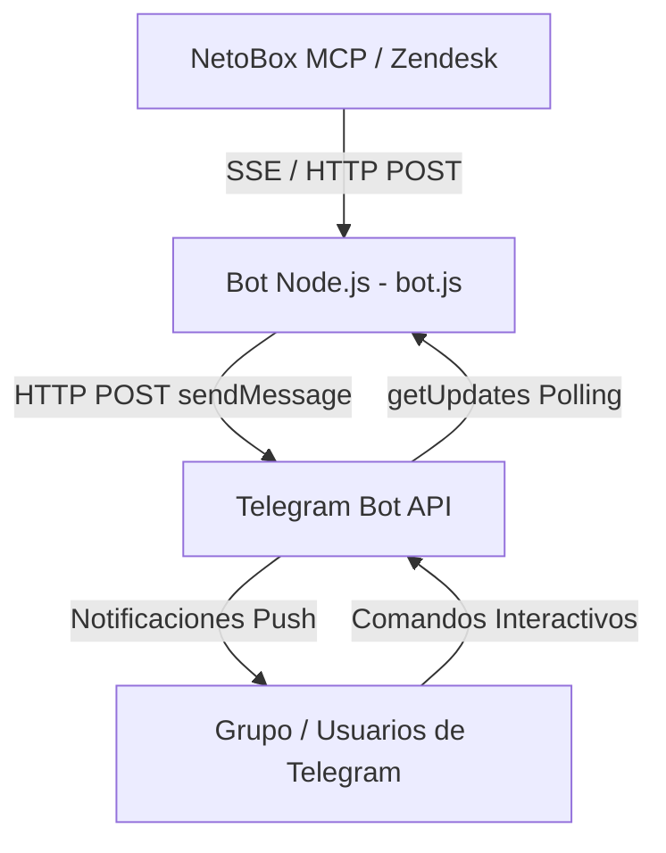

# README.md - Bot de Alertas de Soluciones Neto (Zendesk) en Telegram

`![GCP Always Free]` `![Node.js v20.x]` `![Telegram Bot API]` `![Zendesk / NetoBox MCP]` `![PM2 Process Manager]`

## 1. Descripción General del Proyecto

### El Problema

La aplicación oficial de Zendesk en la plataforma Android presenta fallas graves y persistentes en el envío de notificaciones push en tiempo real. Esta limitación provoca que los supervisores, coordinadores y personal técnico pierdan visibilidad de los folios críticos o retrasen la atención de incidentes operativos generados en la red de tiendas Neto.

### La Solución Arquitectónica

Se diseñó una arquitectura de middleware desacoplada, ligera, resiliente y multi-ingeniero que actúa como un puente de integración entre el sistema de ticketing (NetoBox MCP) y Telegram:

- **Infraestructura Baseline:** Una máquina virtual ligera alojada en Google Cloud Platform (GCP Compute Engine) bajo la capa Always Free (instancia e2-micro).
- **Capa de Datos/Protocolo:** Un script de Node.js ejecutable que consume la API MCP de NetoBox (vía transporte Server-Sent Events / EventSource sobre HTTP) autenticado mediante un Personal Access Token (PAT).
- **Capa de Entrega:** Telegram Bot API ejecutando mediante llamadas HTTP POST directa a los endpoints de mensajería (`sendMessage`).
- **Arquitectura Multi-Ingeniero:** Soporte y gestión de comandos interactivos diseñados para la colaboración de múltiples ingenieros, supervisores y personal técnico de forma simultánea.
- **Gestión de Procesos:** PM2 como process manager de Node.js supervisando el ciclo de vida del servicio, reinicios automáticos y persistencia de registros.

## 2. Diagrama de Arquitectura y Flujo (Mermaid)



## 3. Suite Completa de Comandos Interactivos Documentados

El bot soporta un conjunto de comandos interactivos diseñados para la colaboración multi-ingeniero y el monitoreo de la operación:

- `/start`: Comando de inicialización obligatorio para registrar e iniciar la interacción con el bot o grupo.
- `/status`: Despliega el estado del bot de alertas CSN, reportando si está operativo, la fecha de la última consulta, las alertas enviadas en la sesión y el horario activo configurado.
- `/check`: Permite solicitar una verificación e invocación manual inmediata de alertas hacia NetoBox MCP.
- `/mis_folios`: Muestra la lista de folios asignados o procesados por el ingeniero o usuario que ejecuta la consulta.
- `/silencio`: Comando para pausar o silenciar temporalmente las notificaciones (según la suite de comandos del sistema).
- `/servidor`: Comando de verificación de estado y métricas del servidor donde se ejecuta el proceso.
- `/ayuda`: Muestra la guía de ayuda interactiva con el resumen y la sintaxis de uso de todos los comandos disponibles en el bot.

## 4. Guía de Instalación y Replicación Paso a Paso desde Cero (GCP, AWS, VPS)

### Prerrequisitos y Configuración de Infraestructura

1. **Aprovisionamiento de VM en Cloud/VPS:** Crear una instancia (ej. GCP Compute Engine e2-micro bajo la regla Always Free Tier en regiones us-central1, us-east1 o us-west1) con Ubuntu 22.04 LTS o Debian 12 y disco persistente estándar de 30 GB.
2. **Bot de Telegram y Chat ID:** Generar el bot en @BotFather, obtener el HTTP API Token y consultar el Chat ID (`/start` previo y `curl` a `getUpdates`).
3. **Token PAT de NetoBox:** Personal Access Token generado dentro del perfil de usuario de NetoBox MCP para autenticar el consumo del SSE endpoint.

### Instalación en el Sistema Operativo

Actualizar paquetes e instalar dependencias básicas del SO:

```bash
sudo apt update && sudo apt upgrade -y
sudo apt install -y curl git
```

## 5. Configuración de Seguridad y Variables de Entorno

Para proteger tokens y credenciales sensibles, utilice archivos dotenv y restrinja los permisos de acceso en el sistema de archivos:

### Archivo `.env.example`

```env
TELEGRAM_BOT_TOKEN=tu_telegram_bot_token_aqui
TELEGRAM_CHAT_ID=tu_telegram_chat_id_aqui
NETOBOX_PAT_TOKEN=tu_personal_access_token_aqui
```

### Archivo `.gitignore`

```gitignore
.env
node_modules/
*.log
```

### Protección con permisos `chmod 600`

Aplique restricción de lectura y escritura únicamente al usuario propietario para el archivo `.env`:

```bash
chmod 600 .env
```

## 6. Código Fuente Completo Documentado (`bot.js`)

Código principal `bot.js` documentado exhaustivamente con JSDoc:

```javascript
/**
 * @file bot.js
 * @description Bot de Alertas de Soluciones Neto (Zendesk) en Telegram.
 * Implementa integración con NetoBox MCP vía SSE/JSON-RPC y mensajería en Telegram.
 * Soporta arquitectura multi-ingeniero y comandos interactivos (/start, /status, /check, /mis_folios, /ayuda).
 */

require('dotenv').config();
const cron = require('node-cron');
const https = require('https');

/** @type {string} Token de autenticación del bot de Telegram */
const TELEGRAM_BOT_TOKEN = process.env.TELEGRAM_BOT_TOKEN;

/** @type {string} ID del chat o grupo de Telegram destinatario */
const TELEGRAM_CHAT_ID = process.env.TELEGRAM_CHAT_ID;

/** @type {string} Personal Access Token para autenticación en NetoBox MCP */
const NETOBOX_PAT_TOKEN = process.env.NETOBOX_PAT_TOKEN;

/** @type {Date|null} Fecha y hora de la última ejecución de consulta */
let lastExecutionTime = null;

/** @type {number} Contador total de alertas enviadas en la sesión actual */
let totalAlertsSent = 0;

/** @type {Set<string>} Conjunto de IDs de tickets/folios ya procesados para evitar duplicados */
let processedTicketIds = new Set();

/** @type {number} Último ID de actualización procesado en el polling de Telegram */
let lastTelegramUpdateId = 0;

/**
 * Envía un mensaje formateado en HTML a Telegram mediante HTTP POST.
 * @param {string} text - Contenido del mensaje a enviar en formato HTML.
 * @returns {Promise<Object>} Promesa que resuelve con la respuesta parseada de la API de Telegram.
 */
function sendTelegramMessage(text) {
    return new Promise((resolve, reject) => {
        const payload = JSON.stringify({
            chat_id: TELEGRAM_CHAT_ID,
            text: text,
            parse_mode: 'HTML'
        });

        const options = {
            hostname: 'api.telegram.org',
            port: 443,
            path: `/bot${TELEGRAM_BOT_TOKEN}/sendMessage`,
            method: 'POST',
            headers: {
                'Content-Type': 'application/json',
                'Content-Length': Buffer.byteLength(payload)
            }
        };

        const req = https.request(options, (res) => {
            let responseBody = '';
            res.on('data', (chunk) => responseBody += chunk);
            res.on('end', () => {
                if (res.statusCode === 200) {
                    totalAlertsSent++;
                    resolve(JSON.parse(responseBody));
                } else {
                    console.error(`[TELEGRAM ERROR] HTTP Status ${res.statusCode}: ${responseBody}`);
                    reject(new Error(responseBody));
                }
            });
        });

        req.on('error', (err) => {
            console.error('[TELEGRAM NETWORK ERROR]', err);
            reject(err);
        });

        req.write(payload);
        req.end();
    });
}

/**
 * Formatea una fecha a representación de cadena limpia en zona horaria America/Mexico_City.
 * @param {string|Date} [dateString] - Cadena o date a formatear. Si se omite, usa la fecha actual.
 * @returns {string} Fecha formateada en formato DD/MM/YYYY, HH:mm:ss.
 */
function formatCleanDate(dateString) {
    const date = dateString ? new Date(dateString) : new Date();
    return date.toLocaleString('es-MX', {
        timeZone: 'America/Mexico_City',
        year: 'numeric',
        month: '2-digit',
        day: '2-digit',
        hour: '2-digit',
        minute: '2-digit',
        second: '2-digit',
        hour12: false
    });
}

/**
 * Realiza la consulta de alertas a NetoBox MCP enviando una petición JSON-RPC con la herramienta mail_read.
 */
function fetchNetoBoxAlerts() {
    lastExecutionTime = new Date();
    console.log(`[${formatCleanDate()}] Iniciando consulta de alertas a NetoBox...`);

    const postData = JSON.stringify({
        jsonrpc: '2.0',
        method: 'tools/call',
        params: {
            name: 'mail_read',
            arguments: {
                query: 'Soluciones Neto Alerta',
                max_results: 10
            }
        },
        id: 1
    });

    const options = {
        hostname: 'mcp.netobox.cloud',
        port: 443,
        path: '/sse',
        method: 'POST',
        headers: {
            'Authorization': `Bearer ${NETOBOX_PAT_TOKEN}`,
            'Content-Type': 'application/json',
            'Accept': 'text/event-stream',
            'Content-Length': Buffer.byteLength(postData)
        }
    };

    const req = https.request(options, (res) => {
        let rawData = '';
        res.on('data', (chunk) => rawData += chunk);
        res.on('end', () => {
            if (res.statusCode !== 200) {
                console.error(`[NETOBOX MCP ERROR] Status Code: ${res.statusCode} Body: ${rawData}`);
                return;
            }
            parseMCPResponse(rawData);
        });
    });

    req.on('error', (err) => {
        console.error('[NETOBOX NETWORK ERROR]', err);
    });

    req.write(postData);
    req.end();
}

/**
 * Parsea el payload SSE y JSON-RPC retornado por NetoBox MCP e invoca el procesamiento individual de los elementos.
 * @param {string} rawData - Respuesta cruda obtenida del endpoint SSE.
 */
function parseMCPResponse(rawData) {
    try {
        const lines = rawData.split('\n');
        let itemsToProcess = [];
        for (let line of lines) {
            if (line.startsWith('data: ')) {
                const jsonString = line.replace('data: ', '').trim();
                if (!jsonString) continue;
                
                const parsed = JSON.parse(jsonString);
                if (parsed.result && parsed.result.content) {
                    parsed.result.content.forEach(item => {
                        if (item.type === 'text') {
                            itemsToProcess.push(item.text);
                        }
                    });
                }
            }
        }
        itemsToProcess.reverse().forEach(textData => processEmailText(textData));
    } catch (error) {
        console.error('[PARSE ERROR] Fallo al procesar SSE payload:', error);
    }
}

/**
 * Procesa el texto individual de una alerta, extrae folio, tienda y estado, construye la plantilla HTML y la envía a Telegram.
 * @param {string} textData - Texto plano extraído de la alerta.
 */
function processEmailText(textData) {
    const folioMatch = textData.match(/Folio:\s*#?([A-Z0-9-]+)/i) || textData.match(/Ticket\s*#?(\d+)/i);
    const tiendaMatch = textData.match(/Tienda:\s*([^\n\r]+)/i) || textData.match(/Sucursal:\s*([^\n\r]+)/i);
    
    const folio = folioMatch ? folioMatch[1].trim() : 'N/A';
    const tienda = tiendaMatch ? tiendaMatch[1].trim() : 'Centro de Soluciones Neto';
    
    const lowerText = textData.toLowerCase();
    let headerTitle = '';
    let statusKey = 'NEW';
    
    if (lowerText.includes('resuelto') || lowerText.includes('cerrado') || lowerText.includes('solucionado')) {
        headerTitle = '✅ <b>TICKET RESUELTO/CERRADO CSN</b>';
        statusKey = 'SOLVED';
    } else if (lowerText.includes('actualiz') || lowerText.includes('comentario')) {
        headerTitle = '💬 <b>ACTUALIZACIÓN / COMENTARIO CSN</b>';
        statusKey = 'UPD';
    } else {
        headerTitle = '🚨 <b>NUEVO TICKET DE ALERTA CSN</b>';
        statusKey = 'NEW';
    }
    
    const ticketKey = `${folio}-${statusKey}`;
    
    if (folio !== 'N/A' && processedTicketIds.has(ticketKey)) {
        return;
    }

    const messageHtml = `${headerTitle}\n\n` +
                        `📌 <b>Folio:</b> ${folio}\n` +
                        `🏪 <b>Tienda / Origen:</b> ${tienda}\n` +
                        `🕒 <b>Fecha / Hora:</b> ${formatCleanDate()}\n\n` +
                        `📝 <b>Detalle:</b> Alerta detectada en el sistema Soluciones Neto. Por favor verificar en consola Zendesk.`;

    sendTelegramMessage(messageHtml)
        .then(() => {
            if (folio !== 'N/A') processedTicketIds.add(ticketKey);
        })
        .catch(err => console.error('Error enviando mensaje:', err));
}

/**
 * Escucha y responde interactiva a comandos de Telegram (/start, /status, /check, /mis_folios, /ayuda) mediante Webhook polling.
 */
function pollTelegramCommands() {
    const options = {
        hostname: 'api.telegram.org',
        port: 443,
        path: `/bot${TELEGRAM_BOT_TOKEN}/getUpdates?offset=${lastTelegramUpdateId + 1}&timeout=5`,
        method: 'GET'
    };

    const req = https.request(options, (res) => {
        let data = '';
        res.on('data', chunk => data += chunk);
        res.on('end', () => {
            if (res.statusCode === 200) {
                try {
                    const json = JSON.parse(data);
                    if (json.ok && json.result.length > 0) {
                        json.result.forEach(update => {
                            lastTelegramUpdateId = update.update_id;
                            if (update.message && update.message.text) {
                                const command = update.message.text.trim();
                                const senderName = update.message.from ? update.message.from.first_name : 'Ingeniero';
                                
                                if (command === '/start') {
                                    const startMsg = `👋 <b>¡Hola, ${senderName}!</b>\n\n` +
                                                       `Bot de Alertas de Soluciones Neto (Zendesk) activado e iniciado.\n` +
                                                       `Usa /ayuda para ver los comandos disponibles.`;
                                    sendTelegramMessage(startMsg);
                                } else if (command === '/status') {
                                    const statusMsg = `⚙️ <b>ESTADO DEL BOT DE ALERTAS CSN</b>\n\n` +
                                                       `🟢 <b>Estado:</b> Operativo / En Ejecución\n` +
                                                       `📅 <b>Última consulta:</b> ${lastExecutionTime ? formatCleanDate(lastExecutionTime) : 'Sin registros'}\n` +
                                                       `📊 <b>Alertas enviadas sesión:</b> ${totalAlertsSent}\n` +
                                                       `⏰ <b>Horario activo:</b> 07:00 a 23:00 hrs (Cada 20 min)`;
                                    sendTelegramMessage(statusMsg);
                                } else if (command === '/check') {
                                    sendTelegramMessage(`🔍 <b>Verificación manual solicitada por ${senderName}...</b>`);
                                    fetchNetoBoxAlerts();
                                } else if (command === '/mis_folios') {
                                    const count = processedTicketIds.size;
                                    const foliosMsg = `📋 <b>FOLIOS PROCESADOS EN SESIÓN</b>\n\n` +
                                                       `👤 <b>Solicitante:</b> ${senderName}\n` +
                                                       `🔢 <b>Total folios registrados:</b> ${count}\n` +
                                                       `📌 Consulta la consola Zendesk o NetoBox para el detalle individual.`;
                                    sendTelegramMessage(foliosMsg);
                                } else if (command === '/ayuda') {
                                    const ayudaMsg = `📖 <b>GUÍA DE COMANDOS INTERACTIVOS</b>\n\n` +
                                                      `/start - Inicializar interacción con el bot\n` +
                                                      `/status - Consultar estado operativo del bot\n` +
                                                      `/check - Forzar consulta manual de alertas inmediatas\n` +
                                                      `/mis_folios - Ver resumen de folios procesados en sesión\n` +
                                                      `/ayuda - Mostrar esta guía de asistencia`;
                                    sendTelegramMessage(ayudaMsg);
                                }
                            }
                        });
                    }
                } catch (e) {
                    console.error('Error parseando getUpdates:', e);
                }
            }
        });
    });
    req.on('error', () => {});
    req.end();
}

// Cron Job Programado: Ejecuta cada 20 minutos dentro de la ventana de 07:00 a 23:00 hrs
cron.schedule('*/20 7-23 * * *', () => {
    fetchNetoBoxAlerts();
}, {
    scheduled: true,
    timezone: "America/Mexico_City"
});

// Polling para comandos interactivos cada 10 segundos
setInterval(pollTelegramCommands, 10000);

console.log('=== Bot de Alertas CSN iniciado exitosamente ===');
console.log('Horario configurado: 07:00 a 23:00 hrs (Frecuencia: 20 min)');
```

## 7. Despliegue en Producción y Gestión de Procesos

Para garantizar la continuidad operativa, autoarranque en reinicios del servidor y control de consumo de disco en la VM con PM2:

### Inicio del Servicio y Autoarranque Systemd

```bash
cd ~/bot-alertas
pm2 start bot.js --name "bot-alertas-csn"
pm2 startup systemd
# Ejecutar el comando sudo env devuelto por la consola y guardar:
pm2 save
```

### Prevención de Saturación de Disco (`pm2-logrotate`)

```bash
pm2 install pm2-logrotate
pm2 set pm2-logrotate:max_size 10M
pm2 set pm2-logrotate:retain 7
pm2 set pm2-logrotate:compress true
```

## 8. Guía de Solución de Problemas (Troubleshooting)

### Error 1: "chat not found" o HTTP 400 Bad Request en Telegram API

**Causa:** El `TELEGRAM_CHAT_ID` configurado es incorrecto o no se ha enviado el comando previo `/start` al bot.

**Solución:** Asegúrese de presionar "Iniciar" o enviar `/start` en el chat del bot. Si es un grupo, verifique que el bot tenga permisos de administrador para enviar mensajes y vuelva a consultar el ID mediante `getUpdates`.

### Error 2: HTTP 406 Not Acceptable / Error de Conexión en NetoBox MCP

**Causa:** Omitir la cabecera `Accept: text/event-stream` al realizar la petición POST hacia NetoBox MCP.

**Solución:** Valide en el código `bot.js` que la constante de opciones del HTTPS request incluya explícitamente `'Accept': 'text/event-stream'` y que el PAT token no esté expirado.

### Error 3: "systemd unit not found" o la VM no reinicia el bot tras reiniciar el servidor

**Solución:** Re-ejecute `pm2 startup systemd`, copie y pegue el comando `sudo env...` indicado por PM2 en la terminal y finalice con `pm2 save`.
